

<a href="https://sujay-singh.vercel.app/"></a>

 

 

I'm a Frontend Engineer (SDE-2) with **3.5+ years** building production web apps and SaaS platforms with **React, Next.js and TypeScript**. I specialize in frontend architecture, design systems, rendering strategy (SSR/ISR/CSR), Core Web Vitals, accessibility (WCAG 2.1 AA) and testing, with end-to-end feature ownership and experience mentoring other developers.

These days I build the frontend for AI products: LLM-powered interfaces backed by Next.js, FastAPI, PostgreSQL and RAG.

 



  


<table>
<tr>
<td width="230" valign="top"> <code>Dec 2025 – Present</code></td>
<td valign="top">

### *Fullstack & GenAI Engineer*
**Independent · Freelance**

- Built the marketing site for [Tresori](https://tresori.xyz/), an on-chain wallet infrastructure platform. Next.js, TypeScript, Tailwind, 95+ Lighthouse.
- Building frontends for AI products: RAG chat, document Q&A and AI-assisted content workflows with embeddings, vector search, LangChain and LangGraph.

</td>
</tr>
<tr>
<td width="230" valign="top"> <code>Sep 2022 – Nov 2025</code></td>
<td valign="top">

### *Frontend Developer*
**Kalp Digital Infra / MAI Labs**

- Built a React/Next.js design system from scratch (TypeScript, Tailwind, Storybook, design tokens). WCAG 2.1 AA, shared across products, **~30% faster** feature development.
- Improved Core Web Vitals with SSR/ISR, code-splitting and asset optimization: **2+ seconds faster** loads, 95+ Lighthouse.
- Led migration of legacy React apps to modular TypeScript components.
- Added Jest, React Testing Library and Playwright tests running in GitHub Actions CI.
- Built registration, event-discovery and submission flows for a hackathon platform with **15K+ users**.
- Mentored **4 junior developers** on React architecture and state management.

</td>
</tr>
</table>

 


<table>
<tr>
<td width="50%"><a href="https://github.com/sujaysingh07/blog-fullstack"></a></td>
<td width="50%"><a href="https://github.com/sujaysingh07/RAG-CHAT"></a></td>
</tr>
<tr>
<td width="50%"><a href="https://testkart.in/"></a></td>
<td width="50%"><a href="https://tresori.xyz/"></a></td>
</tr>
</table>

 


Tools I use every day

 
Git · GitHub Actions · Docker · AWS (EC2, ECR) · Nginx · Vercel · Lighthouse · Sentry · Cursor · Copilot · Claude

 

- **AI product UIs:** streaming responses, chat UX, loading and error states for LLM features
- **RAG** retrieval quality and evaluation
- **LangGraph** stateful and agentic workflows
- **React Server Components** and Next.js rendering patterns
- **Performance budgets** and accessibility at design-system level

 


  

<a href="mailto:sujaysingh29@gmail.com"></a>

<a href="https://www.linkedin.com/in/sujay-fullstack/">LinkedIn</a> · <a href="https://sujay-singh.vercel.app/">Portfolio</a> · <a href="https://github.com/sujaysingh07">GitHub</a>

